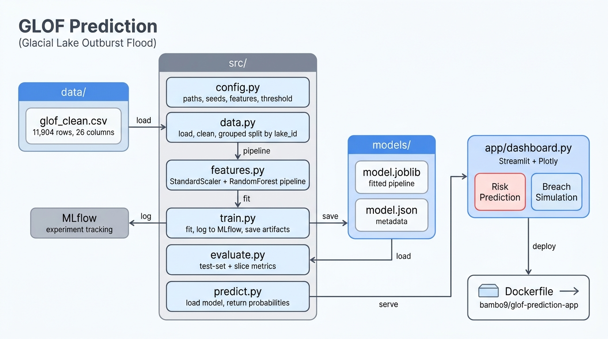
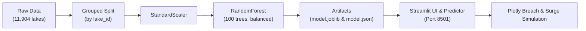

# GLOF Prediction

Predicts whether a glacial lake will burst through its moraine dam within 50 years. We built this around 11,904 lake records from the Himalayas, locked in five geometric features as inputs, and packaged the pipeline into a Streamlit dashboard that pairs classification probabilities with an animated cross-section of the moraine breach.

Built as an applied machine learning coursework project.

## Architecture



The system isolates data ingestion, pipeline training, model persistence, and interactive serving into separate steps:



## Directory Structure

```
├── data/
│   ├── build_ml_GLOF.csv        # raw dataset (11,904 lakes × 16 columns)
│   └── glof_clean.csv           # cleaned observations with engineered features
├── notebooks/
│   ├── 01_data_understanding.ipynb
│   ├── eda_cycle2.ipynb
│   ├── ml_training_testing.ipynb
│   └── finalizing.ipynb
├── src/
│   ├── config.py                # paths, seeds, feature names, decision threshold
│   ├── data.py                  # csv loading, null handling, grouped train/test split
│   ├── features.py              # standard scaler + random forest pipeline definition
│   ├── train.py                 # training loop, mlflow tracking, artifact export
│   ├── evaluate.py              # evaluation metrics and expansion_frac slice testing
│   └── predict.py               # artifact loader and inference wrapper
├── models/
│   ├── model.joblib             # fitted scikit-learn pipeline
│   └── model.json               # metadata with features, threshold, and test metrics
├── app/
│   └── dashboard.py             # streamlit dashboard with dynamic surge wave animation
├── Dockerfile
├── requirements.txt
└── .gitignore
```

## Modeling & Lessons Learned

We locked in a two-stage scikit-learn pipeline: `StandardScaler` feeding directly into `RandomForestClassifier(n_estimators=100, class_weight="balanced", random_state=42)`.

Early iterations surfaced two subtle pitfalls:

1. **Data leakage via repeated measurements:** Standard random splits gave us 0.99 scores that collapsed when evaluated on unfamiliar lakes. Because the raw catalog contains repeated observations of the same lake basins over decades, splitting rows randomly leaked basin topography into the test partition. Enforcing grouped splitting on `lake_id` fixed the leakage.
2. **SMOTE added noise rather than signal:** Synthetic minority oversampling created physically impossible geometry pairs (like massive depth with zero dam volume). Discarding SMOTE and relying purely on balanced class weighting gave cleaner boundary separation and cut down false alarms.

### Input Features

| Feature | Units | Description |
|---|---|---|
| `mean_depth` | meters | Average water depth across the lake basin |
| `volume_dam` | 10⁶ m³ | Moraine dam volume holding back the water |
| `volume_gap` | dimensionless | Freeboard distance between water level and dam crest |
| `uncertainty_frac` | ratio | Satellite measurement uncertainty relative to lake area |
| `expansion_frac` | ratio | Decadal lake area expansion rate |

Target variable: `glof_within_50yr` (binary).

## Quickstart

Requires Python 3.13+.

```bash
git clone https://github.com/Ku-shal9/Applied_ML_GLOF_prediction.git
cd Applied_ML_GLOF_prediction

python -m venv .env
source .env/bin/activate
pip install -r requirements.txt
```

## Running the Pipeline

Train the model and update artifacts:

```bash
python -m src.train
```

This writes run metrics to `mlflow.db` and exports `models/model.joblib` alongside its schema metadata in `models/model.json`.

Evaluate on the grouped test split and inspect slices:

```bash
python -m src.evaluate
```

This outputs precision, recall, ROC-AUC, and Average Precision, followed by sliced metrics segmented across lakes above and below median `expansion_frac`.

Run standalone inference in Python:

```python
import pandas as pd
from src.predict import load_model, predict

model = load_model("models/model.joblib")

sample = pd.DataFrame([{
    "mean_depth": 22.4,
    "volume_dam": 30.4,
    "volume_gap": 0.24,
    "uncertainty_frac": 0.17,
    "expansion_frac": 0.13,
}])

proba, pred = predict(sample, model=model)
print(f"Risk: {'Critical' if pred[0] == 1 else 'Low'} ({proba[0]:.1%} probability)")
```

Launch the interactive dashboard:

```bash
streamlit run app/dashboard.py
```

The interface lets you adjust lake geometry using sliders or pre-configured scenarios. The right pane runs a 60-minute time-lapse simulation displaying the moraine breach, dam crest collapse, and subsequent flood wave travelling toward downstream settlements.

## Docker Deployment

The container is published on Docker Hub under `bambo9/glof-prediction-app:latest`.

Pull and run:

```bash
docker pull bambo9/glof-prediction-app:latest
docker run -p 8501:8501 bambo9/glof-prediction-app:latest
```

Open `http://localhost:8501` in your browser.

To build the image locally:

```bash
docker build -t glof-prediction-app .
docker run -p 8501:8501 glof-prediction-app
```

## Git Branch Layout

- `main`: baseline reference
- `eda-data-prep`: exploratory analysis and data cleaning notebooks
- `model_experimentation`: algorithm comparisons, SMOTE experiments, and metric tracking
- `scripts`: modular production source code (`src/`) and model registry (`models/`)
- `app`: streamlit simulation dashboard, container configuration, and documentation
